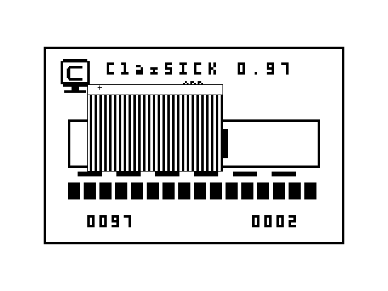
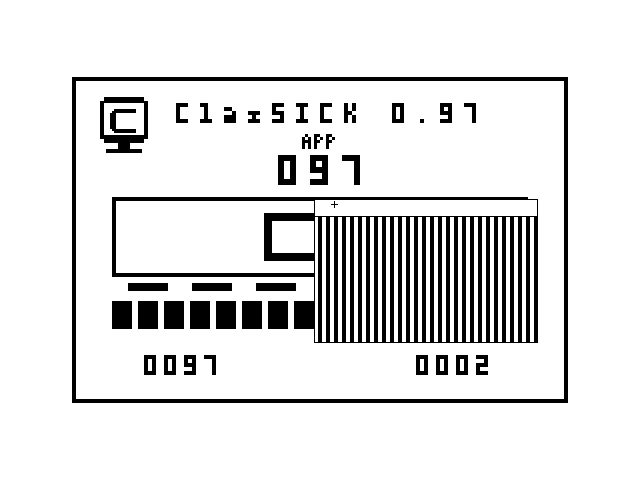
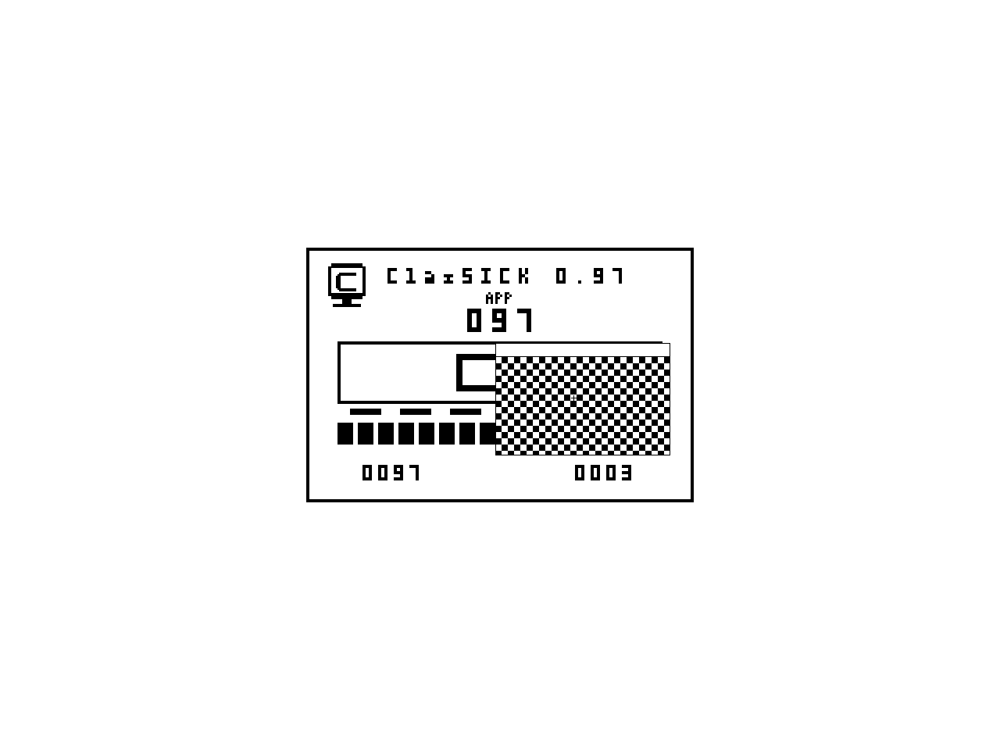

# Hosted native window demonstration - 2026-10-21

Original Windows hosted prototype,not a firmware boot. Input is automated Win32
messages;images are actual hidden-window WM_PRINTCLIENT/GDI client captures.
No desktop,window chrome,reference-system or emulator pixels are included.

49 captured frames,4.2-second repeating out-and-back drag. The fixed-size window
moves over the original branded scene;the cursor follows its title strip and
previously covered pixels are restored. Counter0002 records one content press
and one title press. Animation timing is a presentation choice,not a benchmark.

Dragged striped window at logical250,130;counter0002. Actual640x480 client with
the512x342 scene centered at64,69,without scaling.

1280x960 client retains exactly512x342 scene pixels;white margins expand.
A further synthetic content press changes stripes to checkerboard,counter0003.

All49 decoded GIF frames and both decoded PNGs match captured RGB pixels exactly.
The observer checks each GDI pixel against the native frame and asserts the drag
path/count. This is hosted synthetic evidence,not OS-delivered GUI,human,Mac,
VM/firmware or release qualification. Original ClasSICK pixels,GPL-3.0-or-later.
[Identity and decode audit](../../../development/hosted-window-media.json).
[Implementation and tests](../../../../provenance/records/IMPL-0059-hosted-window-preview.md).
