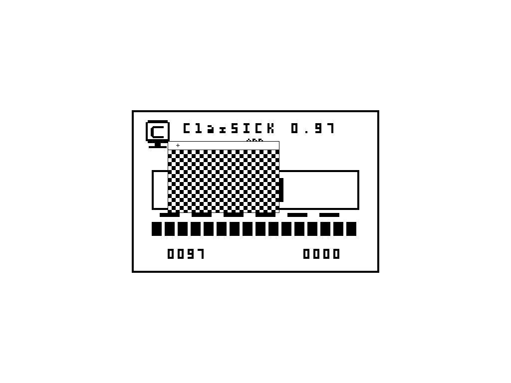

# Native PC window trial and motion sequence

2026-10-23. Fifteen unchanged original framebuffer captures from one isolated
visible VirtualBox boot. The GUI drag failed; separate device-input controls
pass four exact translations, three press edges and a40-second later response.
This is E2 control evidence, not E3/E4 qualification or a release freeze.

The GIF re-encodes eight captured frames; every decoded RGB frame matches its
original PNG exactly. Timing is chosen for presentation, not a speed measurement.
Full1024x768 frame keeps the unscaled512x342 scene centered. No interpolation.

- [Native PC window before input, counter0000.](pc-window-initial.png)
- [Automated GUI drag failed:counter0000 and window fixed; guest cursor clamped.](pc-window-gui-drag.png)
- [Device-control cursor anchored at logical0,0, counter0000.](pc-window-device-anchor.png)
- [Device-control cursor at title100,78, counter0000.](pc-window-device-title-hover.png)
- [Device-control title press starts dragging, counter0001.](pc-window-device-title-down.png)
- [Device-control held drag to window100,80, counter0001.](pc-window-device-drag-1.png)
- [Device-control held drag to window120,90, counter0001.](pc-window-device-drag-2.png)
- [Device-control held drag to window140,100, counter0001.](pc-window-device-drag-3.png)
- [Device-control held drag to window160,110, counter0001.](pc-window-device-drag-4.png)
- [Device-control drag released at window160,110, counter0001.](pc-window-device-drag-release.png)
- [Device-control content press toggles pattern, counter0002.](pc-window-device-content-down.png)
- [Release keeps the pattern and counter0002.](pc-window-device-content-release.png)
- [After40 continuous host seconds the scene stays unchanged, counter0002.](pc-window-device-later.png)
- [A later device-control press still works, counter0003.](pc-window-device-later-down.png)
- [Final device-control release, counter0003; VM subsequently closed.](pc-window-device-final.png)

[Trial and limits](../../../development/release2-integration-evidence.md).
[PNG identities](../manifest.json), [GIF identity](../../animations.json),
[decoded-frame audit](../../../development/native-pc-window-media.json).
GPL-3.0-or-later. Sessions closed, previous VM inventory/media preserved.

Follow-up after desktop access returned (SRC-0416..0418):

- [First Mac native window scene; SCC setup then refuses the unimplemented alias profile.](mac-window-first-boot.png)
- [Corrected host primary-button command reaches the native PC counter,0001.](pc-window-primary-button.png)

[Follow-up findings and limits](../../../development/boot-input-followup.md).

- [Rebuilt Mac ROM reaches stage16/live IRQs; input samples remain unaccepted.](mac-window-irq-running.png)
- [Normal PC GUI presses reach0002, but dragging remains unqualified.](pc-window-gui-primary-drag.png)

These show current failed/partial qualification, not a release or successful drag.

- [Mac first accepted GUI button event,0001; later native diagnostic fault, motion not qualified.](mac-window-first-click.png)
