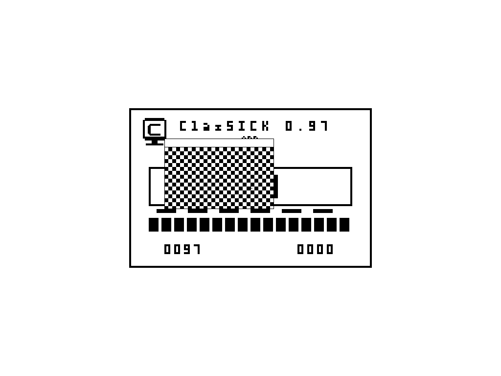

# Live PC input controls — 2026-10-29

Two unchanged original guest exports from one native PC boot. Windows input is delivered under all helper guards with automatic capture Disabled,but the guest pixels stay unchanged. Separate device-level X/Y controls produce a small cursor response. These are diagnostic comparisons,not a successful drag or human-input pass.

[Canonical controls and limits](../../../development/mac-native-pair-evidence.json). GPL-3.0-or-later;original product pixels only.

## Continuing candidates and contrasting cursor

2026-10-29,SRC-0546. Four unchanged own-product framebuffer exports from source-pinned native candidates. The PC cursor is initially visible and later clipped after synthetic capture;the window does not drag. The continuing Mac accepts a click,changes its pattern and reports a tiny displacement with many lost samples. These are diagnostic observations,not successful usability or release tests. [Canonical identities,trace,CI and cleanup](../../../development/release-input-repair.json).

- [pc-contrasting-cursor-start](pc-contrasting-cursor-start.png)
- [pc-contrasting-cursor-clipped](pc-contrasting-cursor-clipped.png)
- [mac-live-pair-start](mac-live-pair-start.png)
- [mac-live-pair-after-input](mac-live-pair-after-input.png)
