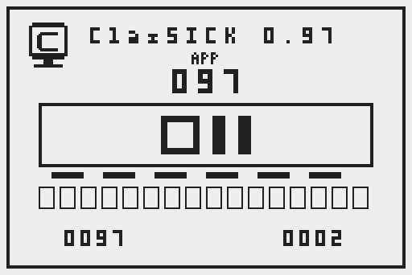
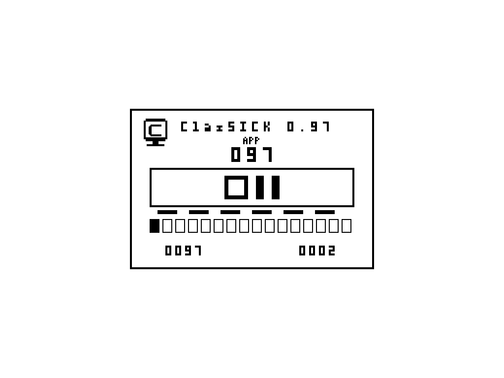

# ClasSICK product screenshots

Latest: [PC before](2026-10-31/pc-cursor15-initial.png) and [after a device-level drag sequence](2026-10-31/pc-cursor15-device-drag.png) with the larger cursor — [test and limitations](../../development/cursor-visibility-20261031.md).

Latest: [PC cursor after a virtual-device recovery from a capture jump](2026-10-31/pc-device-recovery.png) — [test and limitations](../../development/pc-corner-recovery-20261031.md).

Latest: [Mac window after a synthetic drag](2026-10-31/mac-after-device-drag.png) and [after movement following release](2026-10-31/mac-after-device-release.png) — [test and limitations](../../development/mac-controlled-replay-20261031.md).

Machine-readable discovery: [manifest.json](manifest.json). All PNGs below are unchanged captures of the project's own product framebuffer. Captions, source pins, dimensions, hashes, license and observation limits are in the manifest. No Apple or reference-system content, emulator chrome, desktop or credentials are included.

| Capture | Target | Evidence |
| --- | --- | --- |
| [Native68000 selected-port boot: two synthetic mouse presses, counter0002.](2026-10-18/paired-selection-mac-two-presses.png) | native-mac68000 | [Boot trial](../../development/paired-selection-boot-trial.md) |
| [Native x86-64 selected-port boot before input, counter0000.](2026-10-18/paired-selection-pc-initial.png) | native-x86_64 | [Boot trial](../../development/paired-selection-boot-trial.md) |
| [Native x86-64 first synthetic mouse press, counter0001.](2026-10-18/paired-selection-pc-first-press.png) | native-x86_64 | [Boot trial](../../development/paired-selection-boot-trial.md) |
| [Native x86-64 repeated held-button state leaves counter0001.](2026-10-18/paired-selection-pc-held-repeat.png) | native-x86_64 | [Boot trial](../../development/paired-selection-boot-trial.md) |
| [Native x86-64 second synthetic mouse press, counter0002.](2026-10-18/paired-selection-pc-two-presses.png) | native-x86_64 | [Boot trial](../../development/paired-selection-boot-trial.md) |
| [Native x86-64 two synthetic mouse presses plus Space, counter0003.](2026-10-18/paired-selection-pc-after-space.png) | native-x86_64 | [Boot trial](../../development/paired-selection-boot-trial.md) |
| [Native x86-64 normal completion at guest second60, combined counter0003.](2026-10-18/paired-selection-pc-complete.png) | native-x86_64 | [Boot trial](../../development/paired-selection-boot-trial.md) |

Representative matched-counter captures:

See [storage and publication policy](../../development/screenshot-evidence.md). The original private captures and verbose logs remain preserved; this index adds reviewed publication copies.

- [Mac native outline scene before input,counter0000.](2026-10-19/paired-preview-mac-initial.png) — [trial](../../development/paired-preview-boot-trial.md).

- [Mac human-confirmed two-click result,counter0002,drawing intact.](2026-10-19/paired-preview-mac-two-presses.png) — [trial](../../development/paired-preview-boot-trial.md).

- [PC native outline scene before input,counter0000.](2026-10-19/paired-preview-pc-initial.png) — [trial](../../development/paired-preview-boot-trial.md).

- [PC first synthetic mouse press,counter0001.](2026-10-19/paired-preview-pc-first-press.png) — [trial](../../development/paired-preview-boot-trial.md).

- [PC repeated held state leaves counter0001.](2026-10-19/paired-preview-pc-held-repeat.png) — [trial](../../development/paired-preview-boot-trial.md).

- [PC second synthetic press,counter0002.](2026-10-19/paired-preview-pc-two-presses.png) — [trial](../../development/paired-preview-boot-trial.md).

- [PC synthetic two presses plus Space,counter0003.](2026-10-19/paired-preview-pc-after-space.png) — [trial](../../development/paired-preview-boot-trial.md).

- [PC diagnostic completion,counter0006 after mixed synthetic and unreliable owner input; human qualification failed.](2026-10-19/paired-preview-pc-complete-human-attempt.png) — [trial](../../development/paired-preview-boot-trial.md).

- [PC automated follow-up:21 accepted mouse presses plus Space,counter0022; normal diagnostic completion.](2026-10-19/paired-preview-pc-automated-complete.png) — [trial](../../development/paired-preview-boot-trial.md).

- [Continuous native PC preview before input,count0000.](2026-10-19/continuous-preview-pc-initial.png) — [evidence](../../development/preview-session-evidence.md).

- [Continuous preview held repeat counts one press,count0001.](2026-10-19/continuous-preview-first-held.png) — [evidence](../../development/preview-session-evidence.md).

- [Continuous preview second press,count0002;full scene matches Mac.](2026-10-19/continuous-preview-two-presses.png) — [evidence](../../development/preview-session-evidence.md).

- [Continuous preview automated phase at guest second4,count0012.](2026-10-19/continuous-preview-phase-0.png) — [evidence](../../development/preview-session-evidence.md).

- [Continuous preview remains active at guest second68,count0022.](2026-10-19/continuous-preview-phase-65.png) — [evidence](../../development/preview-session-evidence.md).

- [Continuous preview remains active at guest second98,count0032.](2026-10-19/continuous-preview-phase-95.png) — [evidence](../../development/preview-session-evidence.md).

- [Continuous preview remains active at guest second128,count0042.](2026-10-19/continuous-preview-phase-125.png) — [evidence](../../development/preview-session-evidence.md).

- [Continuous preview accepts final Space at guest second185,count0043.](2026-10-19/continuous-preview-pc-final.png) — [evidence](../../development/preview-session-evidence.md).

- [PC window boot,dragging and later input:five reviewed captures.](2026-10-22/README.md) — [TEST-0074](../../development/pc-window-boot-trial.md).

- [Mac timer-path held click,count0001;no motion/drag qualification.](2026-10-26/mac-timer-click.png) — [evidence](../../development/timer-and-pc-input.md).

- [PC raw device control,+1X;no GUI dragging pass.](2026-10-26/pc-raw-device-control.png) — [evidence](../../development/timer-and-pc-input.md).

[2026-10-27 original refresh/PC negative input observations](2026-10-27/README.md):74PNG/twoGIF total;no successful-drag claim.

[2026-10-28 PC physical input:before](2026-10-28/pc-physical-before.png) and [clipped pointer](2026-10-28/pc-physical-clipped-pointer.png). Failed usability;[canonical diagnostic evidence](../../development/release-resumption-evidence.json).

2026-10-29:[Live PC host/device input comparison](2026-10-29/README.md);two own framebuffer PNGs,diagnostic only.

- [2026-10-30 native phase-witness observation](2026-10-30/README.md):new boot capture reuses byte-identical registered pixels;new trace provenance is recorded separately.

[2026-10-30 Mac user-directed jitter observation](2026-10-30/mac-user-jitter.png) — [trace and test limits](../../development/mac-human-witness-20261030.md); no drag or release qualification.

[2026-10-31 PC guarded host drag](../../development/host-input-20261031.md): before, after drag and after release. Pointer positioning used a separate virtual-device control; no human qualification is claimed.

[2026-10-31 PC host-only edge recovery](../../development/host-input-20261031.md#host-only-edge-recovery): original guest captures after downward and upward synthetic host movement; no host-only drag is claimed.

[2026-10-31 PC host-only drag and release](../../development/host-input-20261031.md#host-only-drag-and-release): before, after drag and after release; synthetic host input only.

[2026-11-01 PC optimized-drawing device drag](2026-11-01/pc-mono-span-after-drag.png) — [staged device-input evidence](../../development/mono-span-20261101.md); not a host GUI or human test.

[2026-11-01 PC optimized host drag](2026-11-01/pc-host-sustained-before.png): [before](2026-11-01/pc-host-sustained-before.png), [after](2026-11-01/pc-host-sustained-after.png) and [after release](2026-11-01/pc-host-sustained-release.png). Synthetic host input; [evidence and limits](../../development/mono-span-20261101.md).

[2026-11-01 PC device corner checks](2026-11-01/pc-device-corner-top-left.png): [top left](2026-11-01/pc-device-corner-top-left.png), [top right](2026-11-01/pc-device-corner-top-right.png), [bottom right](2026-11-01/pc-device-corner-bottom-right.png), [bottom left](2026-11-01/pc-device-corner-bottom-left.png), [return inside](2026-11-01/pc-device-corner-return-interior.png). [Evidence and limits](../../development/mono-span-20261101.md).

[2026-11-01 PC device re-entry](2026-11-01/pc-device-reentry-second-drag.png): [second drag](2026-11-01/pc-device-reentry-second-drag.png), [content click](2026-11-01/pc-device-reentry-content-click.png), [boundary drag](2026-11-01/pc-device-reentry-drag-outside.png), [after release](2026-11-01/pc-device-reentry-outside-release.png). [Evidence and limits](../../development/mono-span-20261101.md).

[2026-11-03 PC host corner attempt](2026-11-03/pc-host-corner-attempt.png): the intended corner was not observed. [Evidence and limits](../../development/pc-host-edge-20261103.md).

[2026-11-03 PC host capture calibration](2026-11-03/pc-host-corner-reverse.png): the pointer remained near the lower-right after reverse movements. [Evidence and limits](../../development/pc-host-edge-20261103.md#captured-pointer-calibration).

[2026-11-03 PC paired host-movement attempt](2026-11-03/pc-host-pair-attempt.png): the intended top-left position was not observed. [Evidence and limits](../../development/pc-host-edge-20261103.md#paired-synthetic-movements).

[2026-11-12 Mac candidate two-drag replay](2026-11-12/mac-candidate-anchored-drags.png): original guest image after two synthetic anchored drags; [evidence and limitations](../../development/release-input-20261105.md). This is not a host-capture or physical-input test.

2026-11-12 Mac synthetic corner replay: [top left](2026-11-12/mac-candidate-corner-top-left.png), [top right](2026-11-12/mac-candidate-corner-top-right.png), [bottom right](2026-11-12/mac-candidate-corner-bottom-right.png), [bottom left](2026-11-12/mac-candidate-corner-bottom-left.png) and [return inside](2026-11-12/mac-candidate-corner-return.png). [Evidence and limits](../../development/release-input-20261105.md).

2026-11-12 PC maximum device movements: [right](2026-11-12/pc-max-motion-right.png), [up](2026-11-12/pc-max-motion-up.png), [down](2026-11-12/pc-max-motion-down.png), [diagonal reverse](2026-11-12/pc-max-motion-diagonal-reverse.png). [Evidence and limits](../../development/release-input-20261105.md).

[2026-11-12 BootHush Mac live mouse](2026-11-12/boothush-live-mouse.png): original guest image after automated movement and two clicks. The live held-drag attempt did not deliver a primary press. [Evidence and limits](../../development/boothush-mac-mouse-20261112.md).
