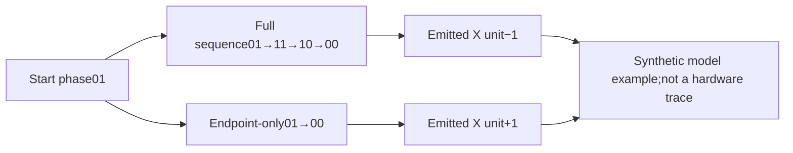

# Same endpoints, opposite output

Original engineering example,27October2026. X axis,invert0,button up.



Full-cadence output−1;endpoint-only output+1. Synthetic model units,not
a captured hardware trace,timing measurement or a release pass.

[Study and executed cases](../input-sampling-study.md). The original
[SVG generator](../../../tools/research/render_sampling_diagram.py) exports a
standalone illustration outside the repository for posting.

Export a new standalone SVG outside the repo (Python3 stdlib only):

```powershell
python -B tools/research/render_sampling_diagram.py --output C:/ClasSICK/endpoint-sampling.svg
```
